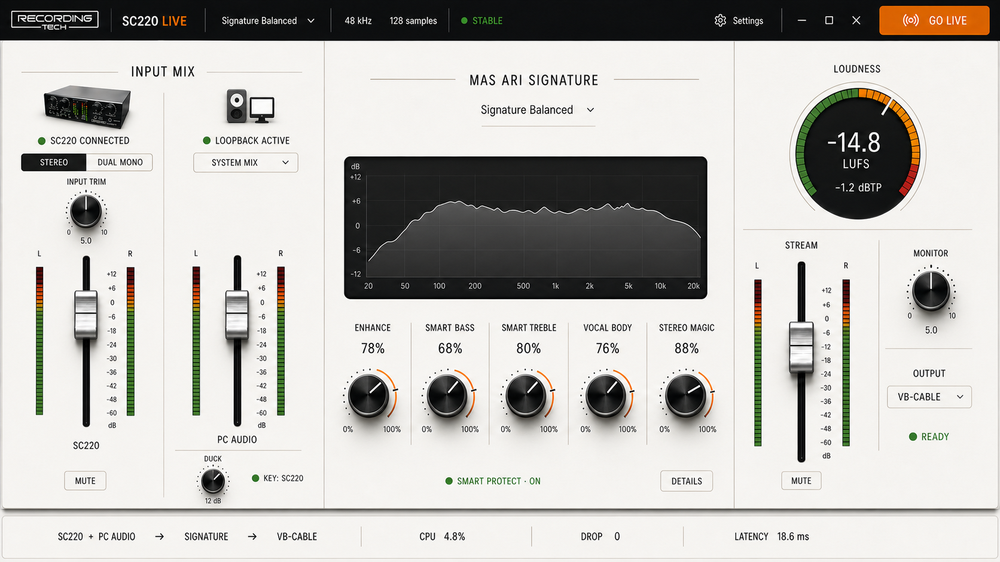

# SC220 Live

Native Windows audio console for Recording Tech SC220. SC220 Live combines an optional SC220 voice input with a selectable Windows playback endpoint, processes Voice and Music through independent ASK-P Signature engines, and sends the protected programme to a Windows stream endpoint such as standard VB-CABLE for OBS, TikTok Live Studio, or another live application.



## Current public release

**SC220 Live v0.1.2** was published on 14 August 2026.

- Public distribution: `masarray/sc220-download`
- Release source commit: `91c33377573b891b99c64aada9b63c4e10517fb3`
- Installer: `SC220-Live-v0.1.2-Setup-win-x64.exe`
- Installer SHA-256: `ba6c61617d8c796dd953234e50f6d2e179c5efbe5e281892da7e7ba977e55693`
- Platform: Windows 10/11 x64

This repository is now public and contains application source and build scripts. The ASK-P DSP authority is still a separate private submodule; publishing this repository does not grant access to that dependency. Never commit signing keys or build credentials.

## Product signal path

```text
Recording Tech SC220
  -> Input Trim -> Voice Signature -> Voice fader ---------------------+
                                                                        |
Selected Windows playback endpoint                                     +-> Master protection / limiter
  -> WASAPI loopback -> Music Signature -> PC fader -> SC220 ducking --+       |
                                                                                +-> stream endpoint -> OBS / live application
```

SC220 is optional for PC Music operation. The programme graph can run with PC Audio only, and SC220 is selected automatically when a matching `MIXER`, `SC220`, or `Recording Tech` endpoint becomes available.

## Current audio authority

SC220 Live pins the approved ASK-P v0.5.24 production authority:

- private authority repository: `masarray/askp-vst`;
- approved product source: `2c764f82b0fc99eaff04d918cef4f839db7509e5`;
- latest audited upstream HEAD for this release line: `44b7d1657fbbd2c13cd490e251e8867734238623`;
- DSP header revision: `2026073102`;
- factory profiles: `13`;
- production DSP contract: canonical source -> fail-closed source audit -> deterministic P0/P0.1/P0.2/P0.3 generator -> generated translation unit;
- Voice and Music use independent processor instances;
- Live creative-control glide: 12 ms; reference parity glide: 80 ms.

The approved processor includes the latest v0.5.24 Gain Match settle-controller fix for source parity, but **SC220 Live keeps Gain Match disabled by default and does not expose a Gain Match control in the public UI**.

See [docs/ASKP_SOURCE_SYNC.md](docs/ASKP_SOURCE_SYNC.md) and [docs/ASKP_P03_DSP_PORT.md](docs/ASKP_P03_DSP_PORT.md).

## ASIO and VST3 Voice FX — development branch

Windows enables JUCE's bundled ASIO backend alongside WASAPI. Select an installed ASIO driver through **Settings → Audio Setup**. ASIO input/output must use the same driver's clock; ASIO input with a separate WASAPI output is not supported without drift correction.

In the **SC220 INPUT** strip, press **+ VST3 FX → Load VST3 effect** and choose a trusted stereo VST3 bundle, such as ArSonVerb. The FX menu also provides the plugin editor, bypass and removal.

Hardware voice flows through trim → dry-only Noise Learn analysis (only during calibration) → VST3 → voice enhancer → learned hiss/expander stages → voice fader → protected master. PC Music never passes through the voice FX slot.

**Real-time hardening:** Native monitor WASAPI COM/render/reconnect runs on a dedicated worker; the audio callback writes to a bounded SPSC FIFO. VST3 loading prepares the candidate before briefly quiescing the audio callback, so plugin changes no longer restart the whole mixer. Bypass uses a 12 ms phase-aligned fade; the active effect keeps processing to preserve reverb tails. ASIO is made available, but switching drivers is **always explicit** to protect saved routing.

**Windows hardware preview:** Checkout this development branch, authenticate Git Credential Manager for the private `masarray/askp-vst` submodule, then run `powershell -ExecutionPolicy Bypass -File .\\scripts\\build-asio-vst3-hardware-preview.ps1` from the repo root. This creates an unsigned local EXE without any hosted CI token. See `docs/REALTIME_SAFETY.md` for physical acceptance tests.

**Limitations:** Generic VST3 plugins are not sandboxed. Plugin state recall, crash isolation and click-free plugin *replacement* are not production-complete. The ASK-P embedded processor contains a fixed lookahead, so do not claim 0 ms input-to-output latency. An actual Windows compile and physical device test are required before a stable release. Official binary publication remains in `sc220-download`.

## Runtime capabilities

- Native JUCE 8 / C++17 Windows 10/11 x64 application.
- Independent Voice Signature and Music Signature engines.
- Selectable Windows WASAPI loopback source for PC Audio.
- Event-driven capture with fallback, endpoint retry, and honest silence telemetry.
- SC220-keyed PC Audio ducking after Music Signature processing.
- Protected final programme bus with safety metering and limiting.
- Physical Monitor Bus with anti-feedback routing protection.
- `PROGRAM` and pre-ducking `MUSIC CUE` monitoring modes.
- Programme analyzer, LUFS-I/LUFS-M, true-peak, stereo meters, faders, mute, and explicit GO LIVE control.
- Smart installer with prerequisite checks for Windows audio, Microsoft Visual C++ Runtime, and optional standard VB-CABLE routing.

## Quick Stream routing

The public installer can optionally install the standard VB-Audio VB-CABLE donationware driver. The normal stream route is:

```text
Music / browser / player
  -> normal Windows speaker or headphone
  -> SC220 Live PC AUDIO SOURCE captures that playback endpoint

SC220 + PC Audio
  -> Voice/Music ASK-P processing
  -> ducking + programme protection
  -> CABLE Input

OBS / TikTok Live Studio
  -> selects CABLE Output
```

A physical playback endpoint must not be used simultaneously as the captured PC Audio source and processed Monitor Output. That creates direct + delayed playback or recursive feedback. Processed monitoring should use a genuinely separate physical endpoint.

## Clone the private source authority

```powershell
git clone --recurse-submodules https://github.com/masarray/sc220-live.git
cd sc220-live
```

The ASK-P repository is private. The GitHub account or CI token must have access before the submodule can initialise.

For an existing checkout, the reviewed authority can be repaired with:

```powershell
.\scripts\sync-askp-v0523.ps1
```

The filename is historical; the script now verifies the approved **ASK-P v0.5.24** source commit.

## One-click Windows build

Double-click `build-sc220-windows.bat`, or run:

```powershell
powershell -ExecutionPolicy Bypass -File .\scripts\build-sc220-one-click.ps1 -Configuration Release -Clean
```

Requirements:

- Windows 10 or 11 x64;
- Visual Studio with **Desktop development with C++** and a Windows SDK;
- Git for Windows;
- Python 3;
- Inno Setup 6 for installer packaging;
- private ASK-P repository access.

## Smart public release

The release launcher is:

```powershell
.\RELEASE-SC220.cmd
```

It is designed to fail closed: source must be clean and pushed, the ASK-P authority must match the lock, and publication is accepted only after the release path verifies the published tag/assets.

The release tooling can repair a clean submodule pointer mismatch, fast-forward a clean local branch, reuse an unfinished Actions run rather than dispatching a duplicate, and retain a verified JUCE 8.0.14 cache to reduce repeated clean-build setup time.

## Repository boundary

- `masarray/sc220-live` — public application source with a private DSP submodule reference.
- `masarray/sc220-download` — public landing pages, release metadata, checksums, manifests, end-user documentation, and compiled release assets.

See [docs/RELEASE_BOUNDARY.md](docs/RELEASE_BOUNDARY.md), [docs/PUBLIC_RELEASE_GATE.md](docs/PUBLIC_RELEASE_GATE.md), and [docs/RELEASE_V0.1.1_RECEIPT.md](docs/RELEASE_V0.1.1_RECEIPT.md).

## Safety notes

- VB-CABLE is a separate VB-Audio donationware product and is installed only when selected by the user.
- Keep Stream and Monitor muted while selecting endpoints and setting gain.
- Never select the same endpoint or virtual-cable family as both PC Audio Source and Stream/Monitor destination.
- Restart Windows after installing or repairing an audio driver when requested.
- Avoid clipping and verify the complete signal path before a production broadcast.

## Linux and macOS build candidates (not public Windows release replacements)

Linux x64 and macOS universal (Intel + Apple Silicon) use
[the existing public distribution authority in sc220-download](https://github.com/masarray/sc220-download/blob/main/.github/workflows/build-portable-release.yml),
[platform limitations and acceptance criteria](docs/PORTABLE_RELEASE.md),
and native CMake presets. The pinned proprietary ASK-P engine stays private.
Only compiled assets may be published to **public sc220-download Releases**
after both platform CI checks pass and an explicit manual release request.

**Not yet feature-equivalent:** Windows-only WASAPI playback capture and
independent physical Monitor Bus are unavailable on Linux/macOS. Do not
market the portable builds as tested production stream mixers until native
capture, monitor routing, real SC220 tests and platform signing are complete.
